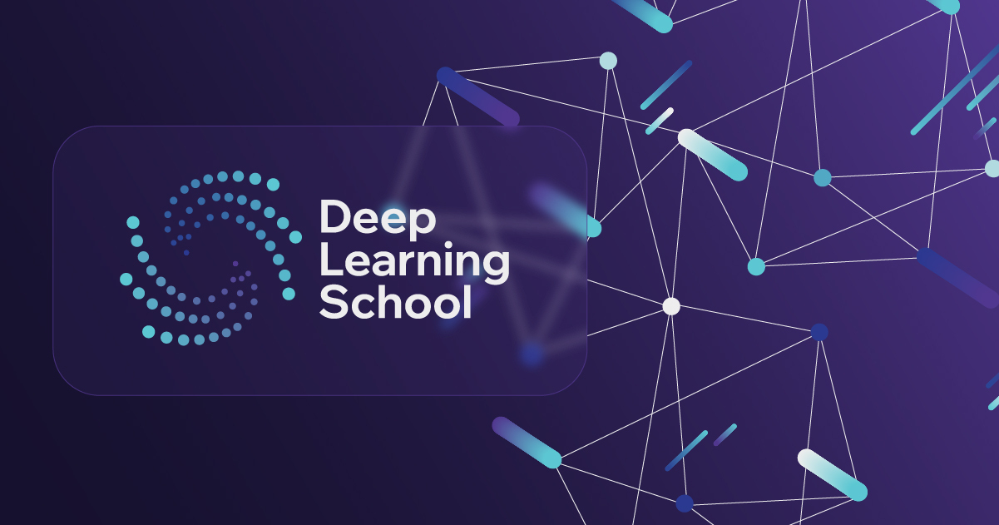

## Материалы модуля 3

  

### Self-supervised Learning

### Лекция

  Запись лекции &laquo;Self-Supervised Learning&raquo; доступна на
  <a href="https://youtu.be/5phU2CWzYIY?si=lsqy1iojDFb2eKfJ" target="_blank" rel="noopener" aria-label="Watch on YouTube" style="text-decoration: none;">
     YouTube
  </a>
  и
  <a href="https://vkvideo.ru/video-155161349_456239404?list=67fd4ea15077d9e5c9" target="_blank" rel="noopener" aria-label="Watch on VK" style="text-decoration: none;">
     VK Видео
  </a>

В этой лекции мы рассмотрим концепцию самообучения (Self-Supervised Learning) и её применение в области аудио. Мы разберём ключевые подходы к обучению — Contrastive Learning, Non-Contrastive Learning и Masked Modeling, а также познакомимся с современными моделями для речи и аудио, которые обучаются без учителя.

Занятие ведёт Иван Разворотнев.

### Семинар

  Запись семинара &laquo;Self-Supervised Learning&raquo; доступна на
  <a href="https://youtu.be/2ezpTsEi4So" target="_blank" rel="noopener" aria-label="Watch on YouTube" style="text-decoration: none;">
     YouTube
  </a>
  и
  <a href="https://vkvideo.ru/video-155161349_456239319" target="_blank" rel="noopener" aria-label="Watch on VK" style="text-decoration: none;">
     VK Видео
  </a>

На семинаре мы на практике реализуем алгоритм самообучения на основе Contrastive Learning, обучим модель для распознавания произнесённых цифр и проанализируем структуру её латентного пространства.

Занятие ведёт Иван Разворотнев.

### Домашнее задание

В этом домашнем задании мы закрепим знания, полученные на семинаре, и подробнее изучим методы самообучения аудио-представлений (self-supervised learning).
Во время семинара мы реализовали и обучили модель на основе контрастного обучения (InfoNCE). Теперь мы расширим эту работу, реализовав методы неконтрастного обучения (Non-Contrastive Learning, NCL) и сравнив их с ранее рассмотренными подходами.

Мы проанализируем, как разные парадигмы обучения — с учителем, контрастная и неконтрастная — влияют на качество получаемых эмбеддингов и стабильность процесса обучения.

